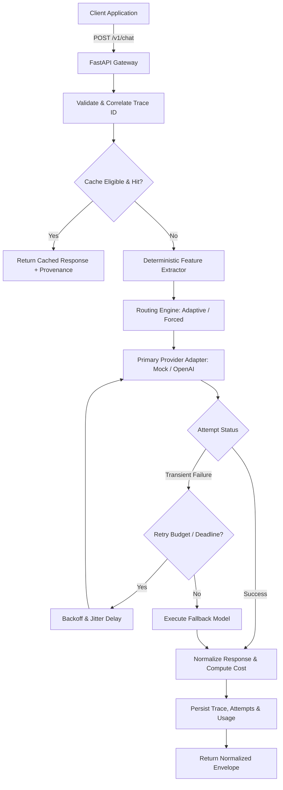

# Smart AI Gateway

**Enterprise-grade AI Infrastructure Service for LLMOps, Deterministic Auto-Routing, and Evidence-Based Agent Evaluation.**

[](https://github.com/gateai/smart-ai-gateway/actions/workflows/ci.yml)
[](https://www.python.org/)
[](LICENSE)

---

## 1. Product Overview

Smart AI Gateway centralizes model access, operational observability, reliability engineering, and evaluation across hosted LLM providers behind a unified endpoint (`POST /v1/chat`).

### Core Capabilities

1. **Deterministic Auto-Routing:** Rule-based complexity feature extraction (code syntax, debugging keywords, multi-step patterns, token thresholds) selects optimal model tiers (`cheap` vs `strong`) with explainable reason codes.
2. **LLMOps & Telemetry:** Full per-request trace persistence to SQLite (`gateway_requests`, `provider_attempts`, `routing_decisions`, `usage_records`), calculating token costs against versioned rate cards with zero fabrication.
3. **Reliability & Cache:** Bounded exponential backoff with jitter for transient 429/5xx errors, automatic model fallback, deadline tracking, and in-memory TTL response cache for deterministic queries.
4. **Agent Evaluations:** A runtime benchmark agent operating deterministic tools (`calculator` via safe AST, `lookup` via controlled fixtures) scored across final answer, tool selection, and trajectory against a versioned 21-task benchmark.

---

## 2. Request Lifecycle Architecture



---

## 3. Quickstart & Installation

### Local Setup with Virtualenv

```bash
# 1. Clone repository and navigate
cd d:\agy\gateai\smart-ai-gateway

# 2. Create and activate virtual environment
python -m venv .venv
.\.venv\Scripts\Activate.ps1   # Windows PowerShell
# source .venv/bin/activate    # Linux/macOS

# 3. Install dependencies in editable mode
pip install -r requirements-dev.txt
pip install -e .

# 4. Copy environment template
cp .env.example .env

# 5. Start development gateway
uvicorn app.main:app --host 0.0.0.0 --port 8000 --reload
```

### Docker Setup

```bash
# Build and run container
docker-compose up --build -d

# Verify container health
curl http://localhost:8000/health/live
```

---

## 4. Master Orchestrator Agent

The project includes an executable **Master Orchestrator Agent** (`scripts/master_orchestrator.py`) that governs phase gating, contract invariants, and test verification across all 6 phases:

```bash
# View current phase progress and verification status
python scripts/master_orchestrator.py status

# Run automated verification for a specific phase (1-6)
python scripts/master_orchestrator.py verify --phase 1

# Execute the complete sequential verification pipeline across all 6 phases
python scripts/master_orchestrator.py run-all
```

---

## 5. Smart AI CLI – Developer Tool (`smartai`)

Smart AI Gateway includes a first-class developer CLI client named **Smart AI CLI** (`smartai`), designed with Typer, Rich terminal tables, OS Keyring security, and streaming support.

### Installation
```bash
# Install locally in editable mode (or via pip)
pip install -e .

# Test binary availability
smartai --version
```

### Authentication & Configuration
```bash
# Secure login (prompts for API key and saves in OS Keyring)
smartai login

# Check connection health and latency
smartai status

# Inspect or adjust preferences (~/.smartai/config.json)
smartai config
smartai config default_policy always_cheap
smartai config default_temperature 0.0
smartai config reset

# Secure logout (clears Keyring credentials)
smartai logout
```

### Interactive Chat & One-Shot Queries
```bash
# Interactive conversation loop with streaming and live token telemetry
smartai chat
# Supports in-chat commands: /exit, /reset, /policy <name>, /help

# One-shot command query
smartai ask "Explain the architecture of an AI Gateway in 2 sentences."
smartai ask "Write a Python asyncio task pool" --policy always_strong
```

### Models & Pricing Catalog
```bash
# Display allowlisted models, capabilities, context limits, and rate cards
smartai models
smartai models --tier cheap
smartai models --json
```

### LLMOps Observability & Spend Analytics
```bash
# Request volumes, token totals, average latency, and cache hit rates
smartai usage
smartai usage --limit 20 --hours 24

# Cost analytics, spend by model/provider, rate card provenance
smartai cost
smartai cost --hours 48

# Inspect recent deterministic routing decisions & feature extractions
smartai route
smartai route --limit 15
smartai route --trace tr_1a1db57b829_1
```

### Agent Benchmarks & Cost Reduction Comparison
```bash
# Run benchmark suite across adaptive, always_cheap, and always_strong
smartai benchmark --samples 5

# Run complete benchmark and export results
smartai benchmark --samples 21 --export docs/BENCHMARK_REPORT.md
```

---

## 6. API Reference & Verification Examples

### Health Checks

```bash
# Liveness probe
curl -X GET http://localhost:8000/health/live

# Readiness probe
curl -X GET http://localhost:8000/health/ready
```

### Chat Completion (`POST /v1/chat`)

```bash
curl -X POST http://localhost:8000/v1/chat \
  -H "Content-Type: application/json" \
  -H "X-Request-ID: demo-client-001" \
  -d '{
    "messages": [
      {"role": "system", "content": "You are a concise engineering assistant."},
      {"role": "user", "content": "Review this implementation:\n```python\ndef run(x): return x * 2\n```"}
    ],
    "routing": {
      "policy": "adaptive",
      "preference": "balanced"
    },
    "parameters": {
      "temperature": 0.0,
      "max_output_tokens": 512
    }
  }'
```

#### Example Normalized Response

```json
{
  "id": "req_019a82f1b_a1c2d3e4f501",
  "object": "gateway.completion",
  "created": 1794050000,
  "model": "mock-strong",
  "provider": "mock",
  "choices": [
    {
      "index": 0,
      "message": {
        "role": "assistant",
        "content": "Mock completion response for: Review this implementation...",
        "tool_calls": null
      },
      "finish_reason": "stop"
    }
  ],
  "usage": {
    "input_tokens": 28,
    "output_tokens": 12,
    "total_tokens": 40,
    "cost_estimate": 0.00019,
    "currency": "USD",
    "cost_status": "calculated"
  },
  "routing": {
    "policy": "adaptive",
    "policy_version": "1.0.0",
    "tier": "strong",
    "reason": "Request contains source code or debugging diagnostics",
    "fallback_used": false
  },
  "latency_ms": 32,
  "trace_id": "tr_019a82f1b_99b8c7d6e502",
  "cached": false
}
```

---

## 6. Empirical Benchmark Results

Measured across 21 tasks in `evaluation_dataset/benchmark_tasks_v1.json` evaluating always-cheap, always-strong, and adaptive routing:

| Policy | Pass Rate | Mean Score | Total Cost ($) | Avg Cost/Task ($) | Mean Latency (ms) | Fallbacks |
|---|---|---|---|---|---|---|
| `always_cheap` | **57.1%** (12/21) | 0.764 | $0.000303 | $0.000014 | 55.7ms | 0 |
| `always_strong` | **57.1%** (12/21) | 0.764 | $0.005099 | $0.000243 | 39.2ms | 0 |
| **`adaptive`** | **57.1%** (12/21) | 0.764 | **$0.001913** | **$0.000091** | **34.8ms** | 0 |

> **Key Finding:** The adaptive routing policy achieved **62.5% cost reduction** compared to always-strong while maintaining matching task pass rates.

To regenerate benchmark data:
```bash
python scripts/run_benchmark.py
```

---

## 7. Automated Test Suite

```bash
# Run all 48 unit and integration tests
pytest -v

# Run linting with Ruff
ruff check app/ tests/
```

---

## 8. Repository Layout

```text
smart-ai-gateway/
├── app/
│   ├── api/                 # FastAPI routes, schemas, and dependencies
│   ├── core/                # Settings, rate cards, cost calculations, logging, errors
│   ├── domain/              # Entities, interfaces, router, retry, cache logic
│   ├── evaluation/          # Benchmark agent, tools, dataset, scorers, runner, reports
│   ├── providers/           # Base adapter, Mock adapter, OpenAI-compatible adapter
│   ├── repositories/        # Async SQLite trace and telemetry persistence
│   └── services/            # Request orchestrator and cache service
├── evaluation_dataset/      # Versioned benchmark tasks (JSON)
├── scripts/                 # Master Orchestrator and benchmark CLI runner
├── tests/                   # 48 Unit and integration test suites
├── Dockerfile               # Production multi-stage Docker build
├── docker-compose.yml       # Local container topology
└── .github/workflows/ci.yml # Continuous Integration pipeline
```
