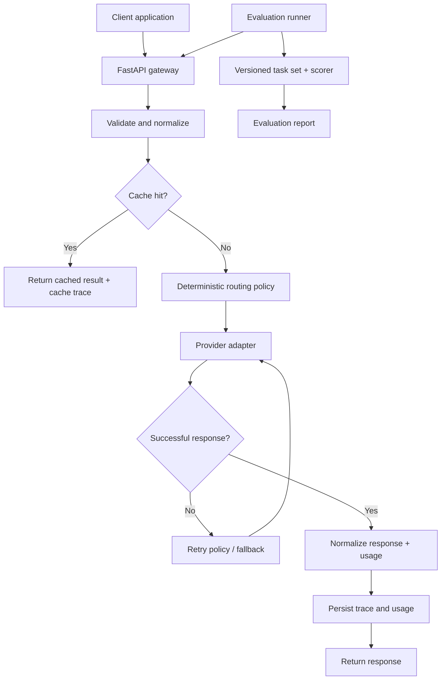

# Smart AI Gateway

**Enterprise-oriented reference blueprint for LLMOps, agent evaluation, and policy-based model routing.**

> This repository is a specification and build-guidance pack, not a prebuilt application. It tells an implementation agent and the developer what to build, why it is built that way, how components interact, and how the result will be verified.

## Product in one sentence

A provider-neutral AI gateway that accepts application requests, routes each request to an appropriate hosted model, handles provider failures, records operational and cost telemetry, and evaluates a tool-using agent against a repeatable benchmark.

## The three integrated capabilities

| Capability | Product responsibility | Evidence that it works |
|---|---|---|
| **Auto-routing** | Select an approved model based on request characteristics and an explicit routing policy. | Route decision, decision reason, cost, latency, and quality comparison against fixed-model baselines. |
| **LLMOps** | Record traces, usage, latency, errors, retries, fallbacks, cache behaviour, and estimated spend. | Queryable request records and operational metrics with no secrets or raw sensitive content leaked. |
| **Agent evaluations** | Run a small tool-using agent through a versioned task set and score the answer, tool use, and execution trace. | Reproducible evaluation runs comparing always-cheap, always-strong, and adaptive-router policies. |

## How a request moves through the system



## Source-brief alignment

The original project brief calls for one gateway, one `POST /v1/chat` request path, hosted OpenAI-compatible model APIs, Python/FastAPI/`httpx`, SQLite first and PostgreSQL later, in-memory cache first and Redis later, a small agent with 2-3 tools, a 20-50 task exam, and a comparison of always-cheap, always-strong, and router policies. This pack preserves those requirements. Additional sections define professional engineering practices around security, testability, operations, and maintainability; they do not change the product into a chatbot or model-training project.

## Recommended technology choices

| Layer | Initial choice | Upgrade path |
|---|---|---|
| API | Python, FastAPI, async endpoints | Keep unless measured need requires a change |
| HTTP | `httpx` async client | Keep; isolate behind provider adapters |
| Model access | Hosted provider API with OpenAI-compatible interface | Add providers through adapter contract |
| Persistence | SQLite for local development and early demo | PostgreSQL for shared or deployed environment |
| Cache | In-memory, bounded TTL cache | Redis when multi-process or shared cache is required |
| Evaluation | Python runner + versioned JSONL task set | Add scheduled evaluation and CI quality gates |
| Packaging | Docker | Same image can be deployed to a cloud runtime |
| CI | GitHub Actions | Add deployment promotion after tests and checks pass |

The project does not require a GPU. Do not host or train foundation models locally. Your Intel i5 / 8 GB RAM machine is sufficient for the gateway, tests, mocked providers, and small evaluation runs; use hosted model APIs for inference.

## Read in this order

1. [`PROJECT_CHARTER.md`](PROJECT_CHARTER.md) — objective, success definition, boundaries.
2. [`SCOPE_AND_NON_GOALS.md`](SCOPE_AND_NON_GOALS.md) — what to build now and what not to build.
3. [`docs/01_PRODUCT_REQUIREMENTS.md`](docs/01_PRODUCT_REQUIREMENTS.md) — requirements and actors.
4. [`docs/02_SYSTEM_ARCHITECTURE.md`](docs/02_SYSTEM_ARCHITECTURE.md) and [`docs/03_COMPONENT_DESIGN.md`](docs/03_COMPONENT_DESIGN.md) — design and component ownership.
5. [`docs/05_API_CONTRACT.md`](docs/05_API_CONTRACT.md), [`docs/06_ROUTING_POLICY.md`](docs/06_ROUTING_POLICY.md), and [`docs/10_EVALUATION_FRAMEWORK.md`](docs/10_EVALUATION_FRAMEWORK.md) — core contracts.
6. [`agents/README.md`](agents/README.md) and [`prompts/MASTER_BUILD_PROMPT.md`](prompts/MASTER_BUILD_PROMPT.md) — how to use coding agents safely.
7. [`docs/22_IMPLEMENTATION_ROADMAP.md`](docs/22_IMPLEMENTATION_ROADMAP.md) — phased delivery plan.

## Repository map

```text
smart-ai-gateway-blueprint/
├── README.md
├── PROJECT_CHARTER.md
├── SCOPE_AND_NON_GOALS.md
├── IMPLEMENTATION_GUIDE.md
├── CONTRIBUTING.md
├── agents/
│   ├── runtime/                 # The benchmarked tool-using agent
│   └── development/             # Optional coding/review agent role specs
├── docs/                        # Product, architecture, contracts, operations
├── prompts/                     # Reusable prompts for implementation and review
└── reference/
    └── original_blueprint/      # Exact 22-file original upload, retained for reference
```

## How the merged documentation is organized

The numbered documents in the root `docs/` folder, the root `agents/` specifications, and the root `prompts/` folder are the **current source of truth** for implementation. The original uploaded blueprint is preserved unchanged under `reference/original_blueprint/` for traceability and to avoid losing any earlier material. Do not follow both versions as competing specifications; when wording differs, follow the enterprise documents at the repository root.

## Important design rule

The router is **deterministic Python policy logic**, not an LLM agent. A language model may be used in a future experiment to classify task complexity, but it must not silently replace the baseline policy. The benchmark must first prove the value of the deterministic router.

## Definition of done

The project is not complete merely because it returns model responses. It is complete when the gateway, routing, reliability, telemetry, agent benchmark, repeatable comparison, tests, documentation, and deployable packaging all work together. See [`docs/21_ACCEPTANCE_CRITERIA.md`](docs/21_ACCEPTANCE_CRITERIA.md).
