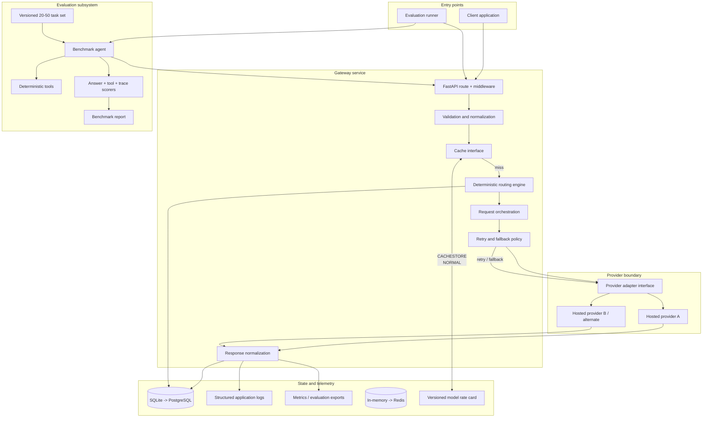

# 02. System Architecture

## 1. Architectural style

Use a modular monolith: one FastAPI service with clearly separated application, domain, provider, persistence, and evaluation modules. This is simpler to run and test than microservices while preserving boundaries that can be separated later if measured scale requires it.

## 2. Logical architecture

## 3. Request lifecycle

1. Client submits an authenticated request with a correlation/trace ID (generated by the gateway if absent).
2. Gateway validates schema, request size, supported parameters, and policy identifier.
3. Gateway checks whether the request is cache-eligible and whether a matching cache entry exists.
4. On a miss, the router classifies request complexity using deterministic, testable signals.
5. Router selects a configured model and emits a `RoutingDecision` containing policy version, tier, model, and reason.
6. Orchestrator invokes the selected adapter with a bounded timeout.
7. Retry policy handles transient failures; fallback may select an approved alternate model.
8. Response normalizer extracts content, finish reason, provider usage, and provider request ID.
9. Cost calculator applies the rate-card version active for the model and usage timestamp.
10. Gateway persists request/attempt/usage/route data and returns the normalized response with trace metadata.

## 4. Component boundaries

- API layer owns HTTP concerns, authentication, schema validation, and response status mapping.
- Domain layer owns routing decisions, request policy, cost calculation, cache eligibility, and retry decisions.
- Provider layer owns provider-specific HTTP payloads, authentication headers, response parsing, and error translation.
- Repository layer owns database reads/writes and migrations.
- Evaluation layer owns task loading, benchmark agent execution, scoring, aggregation, and report generation.
- Infrastructure layer owns cache backend, settings, logging, metrics, and deployment integration.

## 5. Deployment topology

For an initial deployment, run one containerized API service, one persistent database (SQLite only for local/single-instance testing; PostgreSQL for shared deployment), and optionally Redis if shared caching is required. Hosted model APIs are external dependencies. A separate evaluation worker is not required for the first version; the evaluation runner can be a CLI process that calls the gateway.

## 6. Why not microservices?

The workload and team size do not justify distributed service operations. A modular monolith gives testable boundaries without requiring service discovery, queue infrastructure, distributed tracing infrastructure, or multi-service deployment. Split only when a real scaling or isolation requirement is demonstrated.
