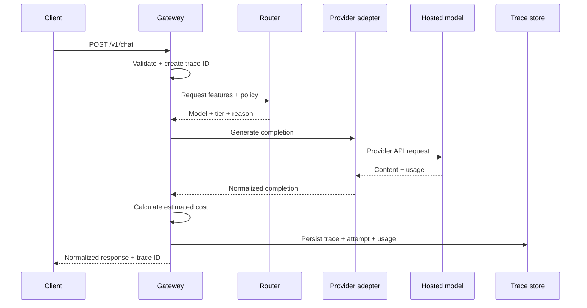
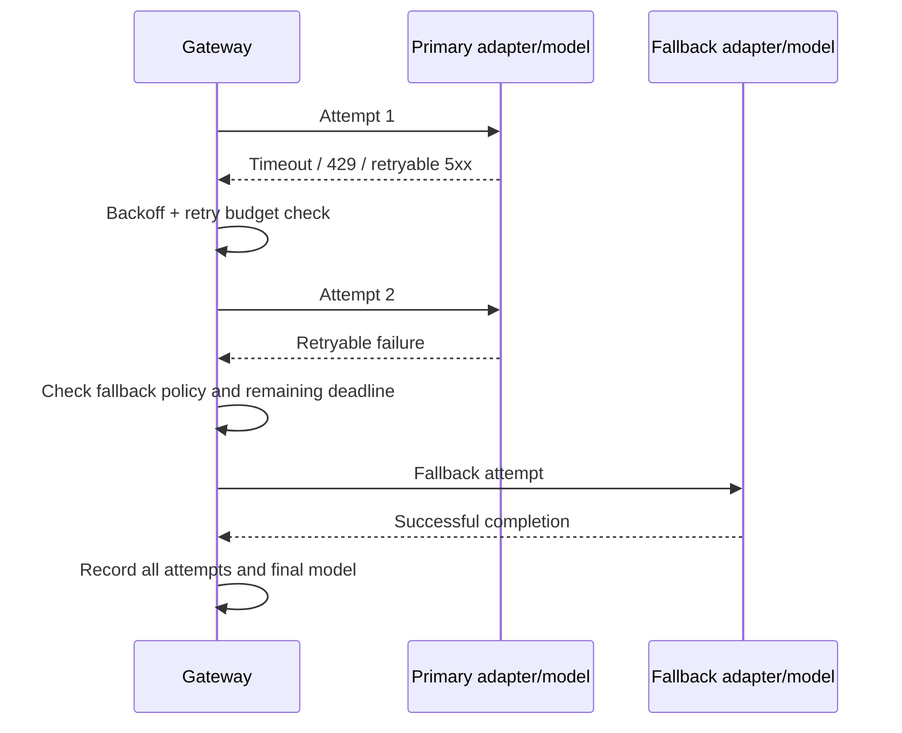
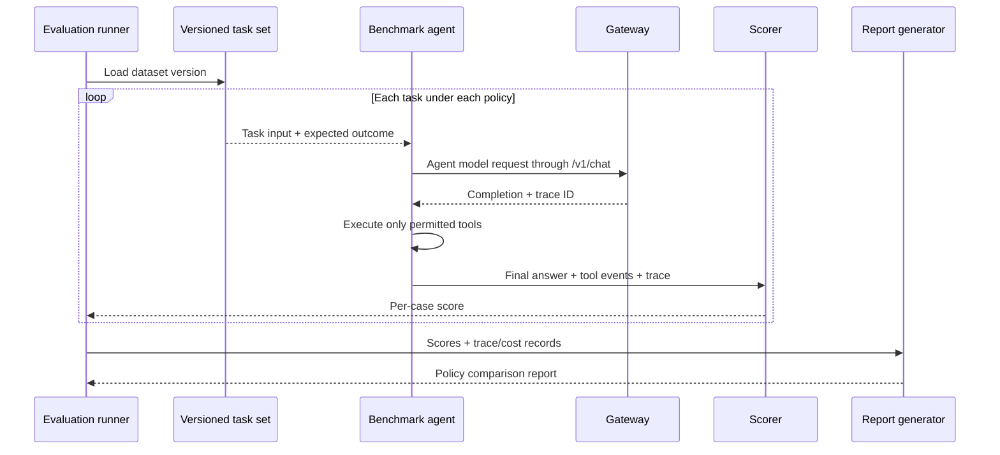

# 04. Sequence Flows

## Successful uncached request

## Retry then fallback

## Evaluation run

## Failure-flow requirements

Every failed attempt must be recorded with attempt number, provider/model, error category, duration, retryability, and whether the request continued through retry or fallback. Sensitive provider response bodies must not be copied wholesale into logs.
