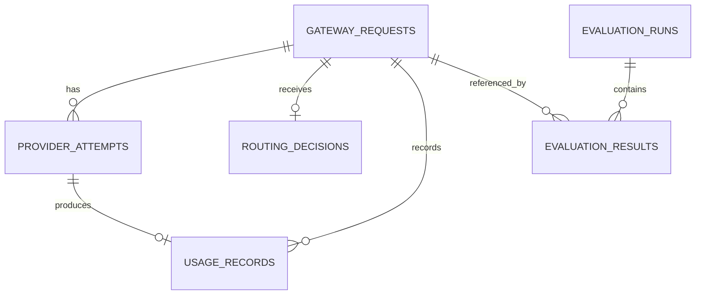

# 12. Data Model

## 1. Logical entities

### `gateway_requests`

One row per logical client request: `id`, `trace_id`, `request_id`, `created_at`, `completed_at`, `environment`, `gateway_version`, `api_version`, `routing_policy`, `routing_policy_version`, `status`, `error_category`, `cache_status`, `final_provider`, `final_model_alias`, `fallback_used`, `latency_ms`, `prompt_fingerprint`, and safe metadata.

### `provider_attempts`

One row per upstream attempt: `id`, `gateway_request_id`, `attempt_number`, `provider`, `model_alias`, `started_at`, `completed_at`, `latency_ms`, `status`, `error_category`, `http_status`, `retry_after_ms`, `is_fallback`, `provider_request_id`, and safe diagnostic metadata.

### `usage_records`

One row per completed model attempt or final billable response, as explicitly defined: `id`, `gateway_request_id`, `provider_attempt_id`, `input_tokens`, `output_tokens`, `total_tokens`, `usage_source`, `rate_card_id`, `input_rate`, `output_rate`, `estimated_cost`, `currency`, `cost_status`, and calculation timestamp. Document whether failed attempts with billable usage are included.

### `routing_decisions`

One row per routing decision: `id`, `gateway_request_id`, `policy_name`, `policy_version`, `selected_provider`, `selected_model_alias`, `tier`, `reason_code`, `reason_message`, `feature_summary`, and timestamp.

### `model_registry`

Configured model alias, provider, upstream model identifier, tier, context/output limits, supported features, active state, and configuration version. Secrets are not stored here.

### `rate_cards`

Model alias/provider, input/output rate, units, currency, effective interval, source note, and version. Do not overwrite historical rate rows; create new effective-dated entries.

### `evaluation_runs` and `evaluation_results`

Run metadata and per-case results: dataset/scorer/prompt/policy versions, git commit, provider/model config, timestamps, case ID, dimension scores, pass/fail, tool events, trace ID, token/cost/latency values, and error state.

## 2. Relationships

## 3. Data integrity

- Use stable primary keys and indexed trace/request IDs.
- Store timestamps in UTC.
- Preserve policy, model, and rate-card versions used for historical calculations.
- Use explicit nullable fields for missing usage; do not coerce unknown to zero.
- Enforce uniqueness for idempotency keys within their intended scope/TTL.
- Apply migrations and test migration rollback where supported.

## 4. Storage progression

SQLite is acceptable for local development and a single-process demonstration. Use PostgreSQL for a deployed or multi-instance service. Avoid sharing a SQLite file across horizontally scaled instances. Keep repository interfaces stable across the migration.
