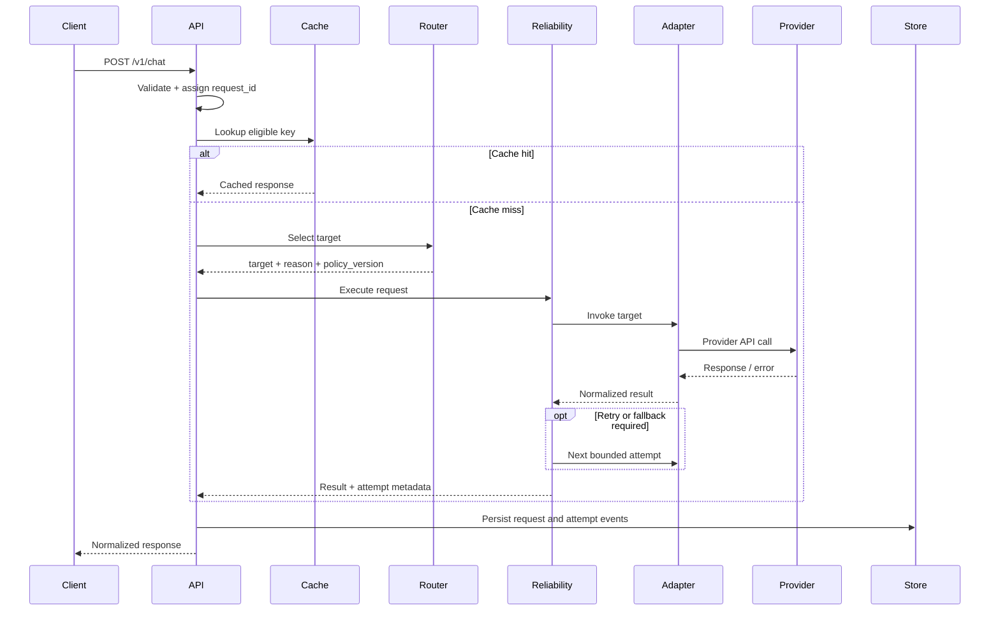

# Request Lifecycle

## 1. Synchronous chat request

1. Client sends `POST /v1/chat` with messages and optional constraints.
2. API authenticates the client, assigns/validates a request ID, and validates the schema.
3. Normalizer creates a canonical request.
4. Cache checks for a valid eligible hit.
5. Router extracts request features and chooses a model.
6. Reliability controller invokes the chosen provider adapter.
7. On transient failure, controller retries within limits.
8. If the primary target remains unavailable and fallback is allowed, controller invokes the fallback target.
9. Response normalizer returns a stable response schema.
10. Telemetry records the final outcome and all attempts.
11. Client receives response and request ID.

## 2. Sequence diagram

## 3. Routing features

MVP features can include:
- Character or token estimate of the input.
- Presence of code blocks.
- Explicit task category supplied by the client, if trusted/validated.
- Requested output format or structured-output requirement.
- Tool-use requirement.
- Context-window requirement.
- Configured model capability and availability.

Do not use prompt length as the sole proxy for difficulty. Keep the initial rules transparent and benchmark them.

## 4. Error behavior

- Invalid request: return a 4xx response; do not call a provider.
- Authentication failure: return 401/403; do not call a provider.
- Provider timeout: retry only within timeout/retry budget; fallback if configured.
- Provider rate limit: respect `Retry-After` when safe and within request deadline.
- Provider server error: bounded retry, then fallback if eligible.
- Provider authentication/configuration error: do not repeatedly retry; alert operator.
- Telemetry failure: follow documented durability policy; do not expose secrets or corrupt response.

## 5. Request identity

One logical request has one `request_id`. Each provider attempt has a distinct `attempt_id`. Retries and fallbacks remain linked to the original request.
