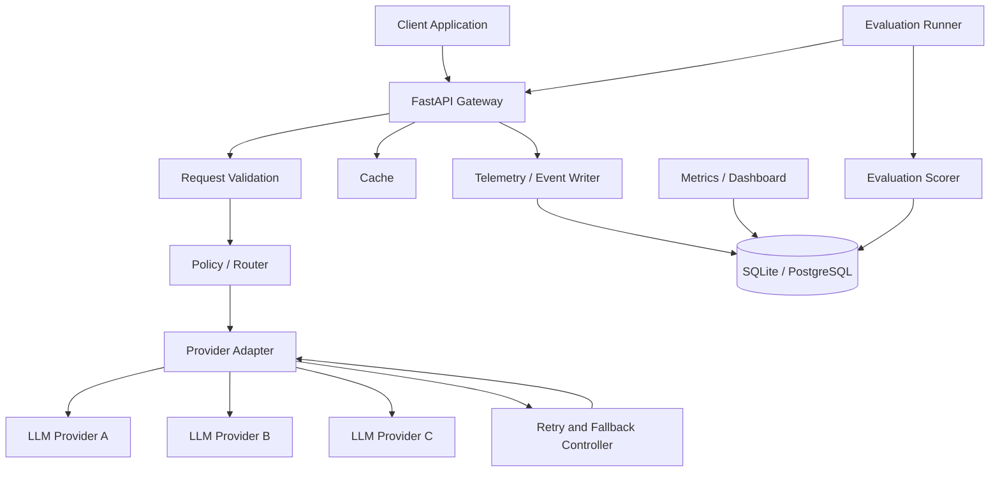

# System Architecture

## 1. High-level architecture



## 2. Component responsibilities

### API layer
- Owns HTTP schemas, authentication boundary, request IDs, and response formatting.
- Does not contain provider-specific logic or routing heuristics.

### Request normalizer
- Validates messages, model constraints, token limits, and optional metadata.
- Produces a canonical internal request representation.

### Router
- Receives request features and the available model catalog.
- Selects a model using a versioned policy.
- Returns a `RoutingDecision`: target, policy version, reason codes, and feature summary.
- Does not make provider network calls.

### Provider adapter
- Converts canonical requests to provider-specific API formats.
- Converts provider responses/errors back to canonical forms.
- Extracts usage when the provider supplies it.

### Reliability controller
- Applies timeout, retry, backoff, and fallback policy.
- Avoids retrying non-retryable client errors.
- Ensures each attempt is separately observable.

### Cache
- Checks eligible requests before provider invocation.
- Cache keys include model/policy-relevant parameters and normalized messages.
- Must not cache unsafe, private, or non-deterministic requests by default.

### Telemetry writer
- Persists request summary and attempt-level events.
- Must not block successful user responses indefinitely; define a bounded write strategy.

### Evaluation runner
- Loads versioned benchmark tasks.
- Invokes the gateway under a named policy.
- Stores raw outputs and scoring details.

### Scorer
- Applies deterministic checks first.
- Uses an LLM judge only as a separately identified, fallible scoring signal when needed.

## 3. Dependency direction

`API -> application services -> router/reliability/cache -> provider interfaces -> provider adapters`

Infrastructure persistence and telemetry are injected into application services. Provider adapters must not import FastAPI routes. Evaluation code should call the public gateway interface or API, not bypass the router.

## 4. Suggested package boundaries

```text
app/
  api/
  schemas/
  core/
  routing/
  providers/
  reliability/
  cache/
  telemetry/
  storage/
  services/
evals/
  datasets/
  runners/
  scorers/
tests/
  unit/
  integration/
  contract/
```

This is a proposed implementation boundary, not a requirement to create every directory in the documentation-only blueprint.

## 5. Scaling path

Start as a modular monolith. Split components into separate services only when load, team ownership, or operational isolation justifies the complexity. PostgreSQL is sufficient for initial request records; Redis becomes useful when multiple gateway instances need shared cache/rate-limit state.
